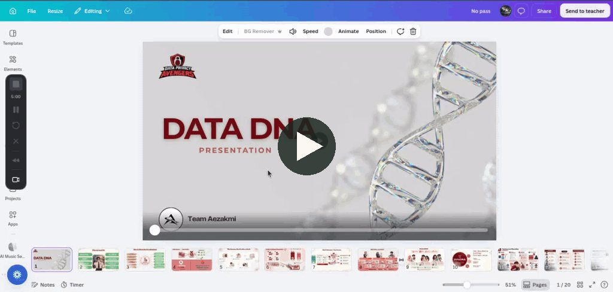
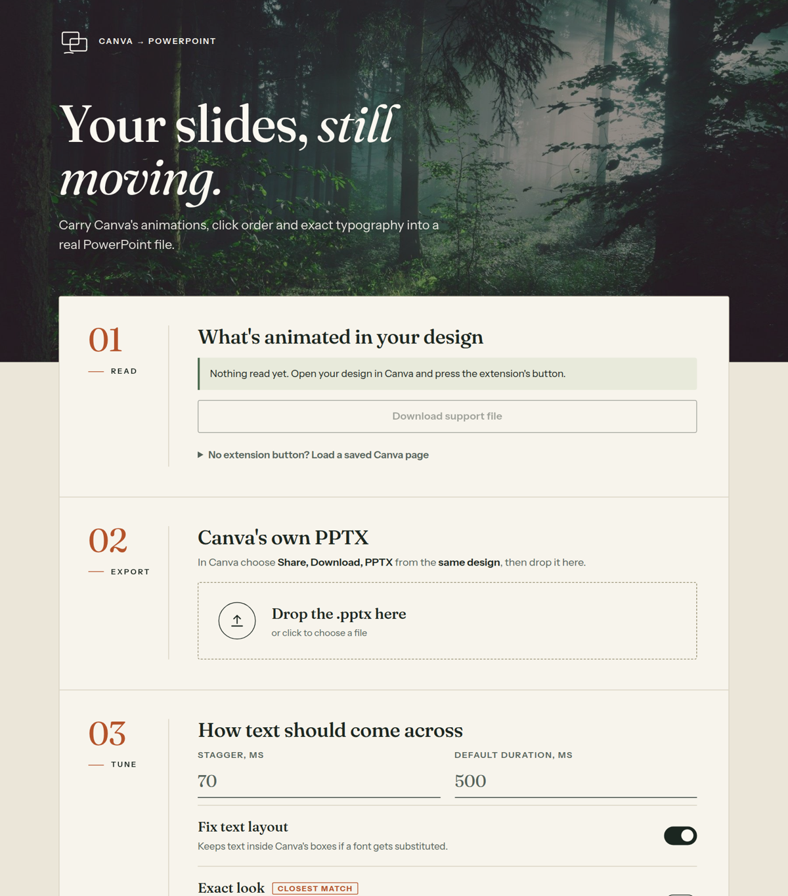
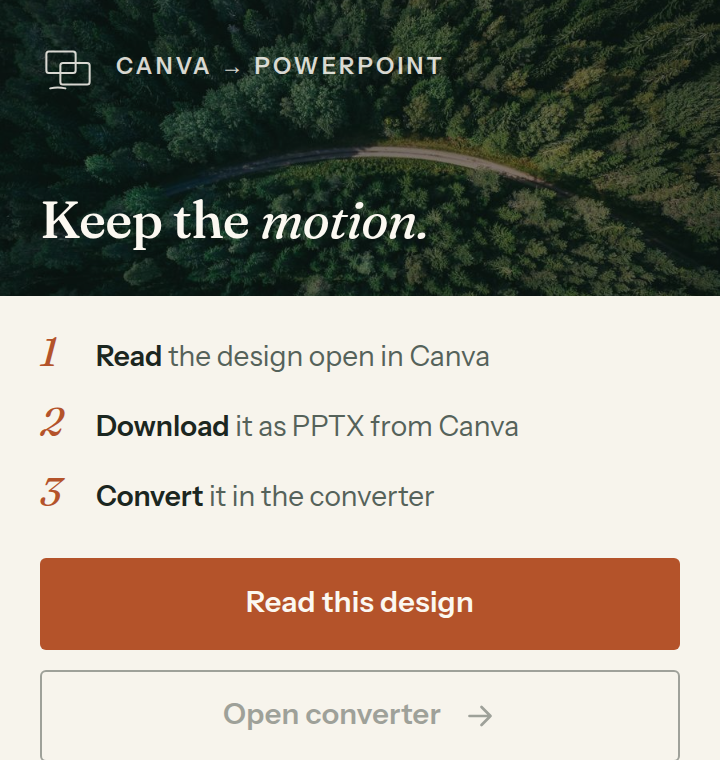

# Canva → PowerPoint

**Bring your Canva animations, click order and exact typography into a real PowerPoint file.**

Canva's own PPTX export drops element animations and on-click sequences, and it can make text look different in PowerPoint. This browser extension reads the animations from your open Canva design and injects them into the PPTX that Canva exports, as native PowerPoint animations. It can also redraw text with Canva's own embedded fonts so it looks identical in any app.

Everything runs locally in your browser. Nothing is uploaded.

<p align="center">
  <a href="https://www.loom.com/share/2378d922811649b788ba4d074030f99c">
    
  </a>
  <br><sub><a href="https://www.loom.com/share/2378d922811649b788ba4d074030f99c"><b>Watch the demo</b></a> to see it work end to end.</sub>
</p>

<p align="center">
  
  
</p>

> Unofficial. Not affiliated with, endorsed by, or sponsored by Canva or Microsoft. See [Disclaimer](#disclaimer).

## Install

The extension isn't in the Chrome Web Store yet. Install it from source (Chrome, Edge, Brave):

1. Download the latest zip from [Releases](../../releases), or clone this repo.
2. Open `chrome://extensions` and switch on **Developer mode**.
3. Click **Load unpacked** and choose the `extension` folder.

## Use

1. Open your design in Canva (wait for it to show *Saved*). Click the extension, then **Read this design**.
2. In Canva choose **Share → Download → PPTX**, from the same design.
3. Click **Open converter**, drop in the `.pptx`, tick the options you want, and press **Convert**.

You get `<name> (animated).pptx` with your animations, in your click order.

## What carries over

- **Animations.** Automatic ones (play when the slide appears) and on-click steps in Canva's own order. Elements that share a step play together.
- **Durations.** Taken from Canva when present.
- **Text fidelity**, in three levels you can combine:
  - *Fix text layout* (on by default). Keeps text inside Canva's boxes if a font gets substituted: removes doubled bold, keeps one-line text on one line, and lets multi-line text shrink instead of growing over its neighbours.
  - *Exact look.* Draws every text box with Canva's embedded fonts and places it as a picture. Identical in every app, but not editable. Animations still work.
  - *Compatibility mode.* Swaps fonts for Arial/Times resized to Canva's exact widths. Stays editable.

### Effect mapping

| Canva effect | PowerPoint | Exact? |
| --- | --- | --- |
| Fade | Fade | yes |
| Rise, Pan | Fly in | yes |
| Wipe | Wipe | yes |
| Pop | Zoom | yes |
| Baseline, Block, Typewriter | Wipe | approximated |
| Ascend, Drift, Shift, Roll, Skate, Photo Rise | Fly in | approximated |
| Tumble, Stomp, Burst, Spread, Breathe, Bounce, Photo Zoom | Zoom | approximated |
| Blur, Neon, Merge, Succession, Clarify, Photo Flow, Captions | Fade | approximated |

Every approximation used is listed in the report after converting.

## How it works

1. Canva embeds the whole design state in the editor page. The content script fetches it and the extension decodes it locally, finding each page's elements, effects and click steps.
2. You supply Canva's own PPTX export, which already has the right shapes, images and fonts.
3. The extension matches each animated Canva element to its PPTX shape (by position and text), then writes PowerPoint's timing XML (`<p:timing>`) with the right click groups.
4. Optionally it re-draws text using the font files Canva embeds in the export.

The logic lives in [`extension/core.js`](extension/core.js) and is plain JavaScript with no build step.

## Known limits

- Some Canva effects have no PowerPoint equivalent and are approximated (table above).
- Entry **directions** use a best-guess mapping that hasn't been fully verified. Page transitions are carried as a fade.
- It reads the design as last **saved** by Canva.
- It depends on Canva's internal page format, which can change without notice. If it breaks, [open an issue](../../issues/new/choose) with the *support file* the converter can download.
- With *Exact look*, text becomes a picture and can't be edited. Text with gradients, theme colours or numbered lists, and text inside rotated groups, stays as live text.

## Development

```bash
cd extension
npm ci
npm test
```

The test-suite runs on Node with a synthetic PPTX, so it needs no Canva account. See [CONTRIBUTING.md](CONTRIBUTING.md).

## Disclaimer

This is an independent open-source project. "Canva" and "PowerPoint" are trademarks of their respective owners and are used only to describe what the tool works with. It reads data your browser already received for a design you have open, and writes a file on your own computer. Please check Canva's terms of use before relying on it, and expect that format changes on Canva's side can break it.

## License

[MIT](LICENSE). Third-party material is listed in [THIRD_PARTY.md](THIRD_PARTY.md).
